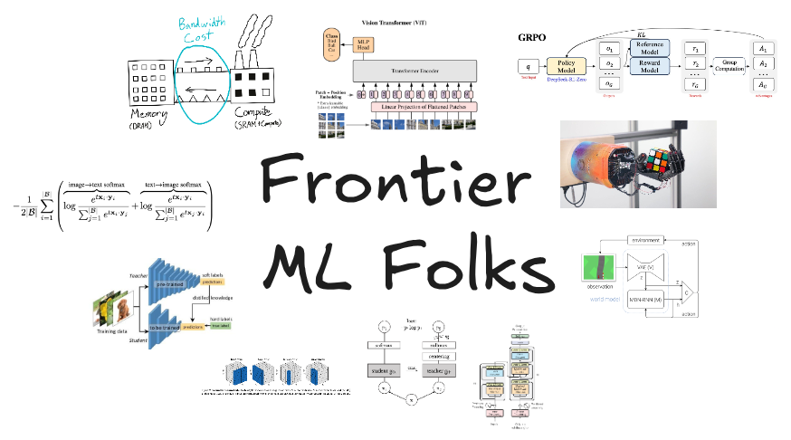

<h1 align="center">Frontier ML Folks</h1>

---

Frontier ML Folks is a group of researchers and hobbyists larping to be working on the frontier of AI/ML.

To be a part of Frontier ML Folks, you don't necessarily have to be an expert at AI/ML but rather you just need to larp your way to make it seem like you know what you're talking about. Keep throwing buzzwords every now and then like **"RSI"**, **"singularity"** etc and you'll be good to go.

A plus point would be if you're good at just larping by sharing every **blog** / **article** / **research paper** you find on twitter and other social media, knowing that you're never going to be reading it whatsoever.

<i>"Future depends on what you larp today"</i>
 
— Mahatma Gandhi

  <a href="http://larpring.com/">Frontier ML Folks Webring</a>

 

   

